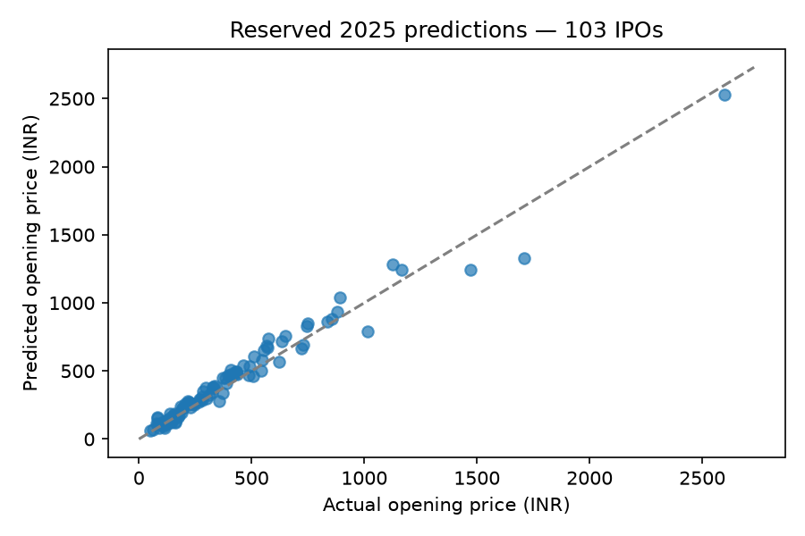
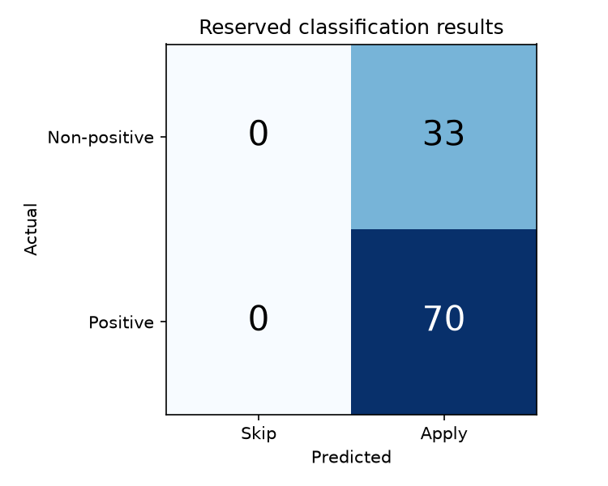

# IPO Listing Prediction

Final implementation report | 24 October 2026

## Abstract

This project implements a reproducible Indian mainboard IPO workflow with two outputs: listing opening price and a positive-listing-gain Apply/Skip signal. Prepared information is restricted to S0, 09:00 IST on the first bidding day. The cohort contains 253 IPOs first listed in 2023–2025. Chronological validation compares 19 candidates, freezes model choices and then evaluates 103 reserved IPOs. A custom historical web interface uses saved held-out predictions, with separately labeled development and training examples.

The selected price method has reserved MAE INR 49.86; announced cap alone has MAE INR 44.95. The selected classifier achieves 67.96% accuracy by predicting Apply for every IPO, matching the majority baseline. The 90% aspiration and useful Skip detection were not achieved. The delivered contribution is an auditable workflow and working demonstration, with measured model limitations.

## 1. Problem, scope and outputs

An investor-facing forecast must use information available when the decision could be made. S0 is before bidding starts, so final subscription totals, final issue price and listing outcomes cannot be predictors. The regression target is listing opening price in INR. The classifier target is 1 when opening price exceeds final issue price, and 0 otherwise; equality is non-positive. The two outputs come from separate methods and can disagree.

Apply means predicted positive listing gain before transaction costs and without allotment assumptions. It is not a validated investment-profit strategy. The implemented interface demonstrates historical IPOs rather than collecting live IPO data. Day-wise stages, expanded anchor reputation, post-listing sell/hold and economic backtests are deferred.

## 2. Data sources and prepared cohort

The prepared inputs combine IPO profiles and announced issue terms, an independent cross-exchange listing cohort/verification snapshot, financial extractions from dated pre-bid offer documents, corroborated lead-manager identities, and earlier Nifty/VIX observations. Source names, reconciliations and hashes are retained in the bundled provenance reports. No new download is required to run the models or app.

| Item | Prepared coverage |
| --- | --- |
| Mainboard IPOs first listed 2023–2025 | 253 |
| Original allowed S0 predictors | 52 |
| Core model predictors | 12 |
| Optional financial predictors | 7 |
| IPOs with usable annual income/PAT | 135 of 253 |
| IPOs with corroborated managers | 222 of 253 |
| Frozen development / reserved / excluded | 149 / 103 / 1 |

Financial extraction coverage is incomplete and the history of managers starts with this cohort. Original heavy raw PDF archives, SME tables and day-wise subscription sources are not runtime inputs. Historical source-path references are provenance, not dependencies outside this package. Rebuilding the original PDF extraction would require the earlier archives. Original source licensing remains applicable.

## 3. Cleaning and validation

Earlier preparation normalized issuer identities, matched entities using ISIN/symbol/name evidence, reconciled listing dates and original listing venues, standardized units and separated financial reporting periods. Reviewed conflicts include original versus later exchange admissions, aliases, and final issue prices that differ from the announced cap. Financial header order was corrected only where source evidence supported it; reported amounts and genuine outliers were preserved.

The runtime loader checks the 253 unique IPO IDs, exact table coverage, schema and label consistency, positive finite target prices, gain and classification formulas, timezone and the S0 cutoff. Final issue price remains label metadata. No target is imputed. Numeric missing values are retained until fold-specific preprocessing. Median imputation, training-derived missing indicators and optional scaling are fitted on training rows only; entirely missing training columns are retained with zero fill and an indicator.

The historical extraction audit records 25 checks; the imported EDA audit records 20 checks. Part 1 adds seven readiness checks. Separate tests exercise leakage rejection, label maturity, preprocessing, relocation, saved-model replay and the app. These gates check implementation consistency; they do not prove all historical publication timestamps.

## 4. Exploratory analysis and feature choices

Development EDA uses 149 IPOs. Positive listing gains occur in approximately 78.5% of them, making an always-Apply comparison necessary. Annual income/PAT are available for 76 development IPOs; complete-case deletion would remove many observations. The target is right-skewed and genuine extremes were retained. Strong predictor redundancy and period-varying associations motivate a compact core rather than unrestricted feature search.

| Group | Core predictors |
| --- | --- |
| Announced terms | Band cap; relative band width; lot application cost; log planned offer size |
| Market context | Nifty 21-session return; 21-session volatility; VIX close |
| Recent IPO context | Prior 90-day listing count; median gain |
| Manager history | Verified manager count; prior IPO count; median prior gain |

The optional seven-variable financial extension adds annual income, PAT margin, income growth, loss status, income/PAT definition flags and financial age. It was compared only using development validation. The winning specifications use the core set. Announced bands/lots and dated RHP availability carry documented assumptions because exact historical publication timestamps are absent; no unverified anchor feature is admitted.

## 5. Chronological evaluation design

Membership uses the S0 date and label availability, not just listing year. Four expanding 2024 validation folds require training S0 and label availability strictly before the first validation cutoff. Same-cutoff IPOs stay together. Fitting/preprocessing are frozen within a quarter. One December-to-January boundary IPO is excluded because its outcome was unavailable at the final fit cutoff.

| 2024 fold | Train | Validation | Unmatured rows purged |
| --- | --- | --- | --- |
| Q1 | 59 | 22 | 0 |
| Q2 | 80 | 14 | 1 |
| Q3 | 94 | 26 | 1 |
| Q4 | 121 | 28 | 0 |

Each of 90 validation IPOs is scored once per candidate. Settings were frozen before final fitting on 149 IPOs at 6 January 2025, 09:00 IST. Both final pipelines stay fixed for 103 reserved IPOs. Market and historical-context snapshots may incorporate earlier outcomes observable before each later IPO's S0; this is not test-target fitting. Earlier preparation displayed full-cohort aggregate outcomes, so the reserved set is not claimed as unseen external data.

## 6. Model development and selection

Ten regression candidates cover announced cap, training-median premium, Ridge with two alpha values and two restrained Random Forest settings, with core/extended feature comparisons. Nine classifier candidates cover always Apply, logistic regression with/without class balancing and two forest settings, again with both feature sets. There are 76 audited candidate/fold fits. Random state is 42. The probability threshold is fixed at 0.5; no threshold search was performed.

The premium baseline multiplies the announced cap by the median of training opening-price/announced-cap ratios. Learned price models use a prespecified INR 0.01 physical floor. Regression ranking uses pooled MAE, then RMSE and simplicity. Classification ranking uses accuracy, then balanced accuracy, Brier score and simplicity. A baseline can win. Validation outcomes used for choosing models are optimistic selection estimates, not independent final performance.

| Selected method | Development validation |
| --- | --- |
| Price: training-median-premium baseline | MAE INR 94.45; RMSE INR 158.02; MAPE 17.97% |
| Classifier: core Random Forest | Accuracy 77.78%; balanced accuracy 50.00% |
| Always Apply on the 90 validation IPOs | Accuracy 77.78% |

The core forest has 200 trees, maximum depth 3, minimum leaf size 5, sqrt feature sampling and no class weighting. Its decision accuracy ties always Apply; a lower Brier score breaks the prespecified tie. It makes no Skip predictions in validation. The best learned price challenger is retained among the development artifacts, but the baseline wins the primary price criterion.

## 7. Reserved evaluation results

| Method | MAE (INR) | RMSE (INR) | MAPE |
| --- | --- | --- | --- |
| Frozen selected price method | 49.86 | 73.49 | 14.97% |
| Announced cap | 44.95 | 98.22 | 11.14% |

Announced cap has lower reserved MAE and MAPE, while the frozen selected method has lower RMSE. The model is not switched after viewing this result. MAPE is not classification accuracy; 100 minus MAPE is not a probability of correct prediction. Rupee error also depends on IPO price level.

| Classifier metric | Frozen Random Forest | Always Apply |
| --- | --- | --- |
| Accuracy | 67.96% | 67.96% |
| Balanced accuracy | 50.00% | 50.00% |
| Apply precision | 67.96% | 67.96% |
| Apply recall | 100.00% | 100.00% |
| F1 (Apply) | 0.8092 | 0.8092 |
| Brier score (lower is better) | 0.2263 | 0.3204 |
| Correct non-positive listings | 0 of 33 | 0 of 33 |

Seventy of 103 IPOs have positive gains. The classifier predicts Apply for all 103: TP=70, FP=33, TN=0, FN=0. Its accuracy therefore equals the majority baseline. A lower Brier score does not establish useful Skip decisions or calibrated investment confidence. The 90% aspiration is not reached.

## 8. Implementation and demonstration

The stack is Python, pandas, NumPy, scikit-learn, Matplotlib, joblib, Jupyter, a Starlette/Uvicorn API and a custom HTML/CSS/JavaScript frontend. The tested environment is Python 3.14 on Linux/WSL; exact versions are locked. Reusable package modules handle loading, splits, guards, metrics, training and final evaluation. All runtime inputs, outputs and code are inside the deliverable, with paths independent of the enclosing folder name.

The user enters an IPO name or stock symbol and presses Predict. A table displays estimated listing price, Apply/Skip signal, raw positive-gain probability and announced band. A separate historical IPO box supports browsing. Saved results cover 103 reserved and 90 development validation IPOs; 59 earlier training examples are explicitly labeled retrospective illustrations. One excluded boundary IPO has no prediction. Actual outcomes are loaded separately on request, and model performance is available in a details dialog. The app does not fit a model or search the web.

Both final pipelines contain exact development training IDs, ordered features and cutoff metadata. Reloaded pipelines reproduced all held-out predictions. The evaluation receipt checks input/code/artifact hashes and prevents silent reevaluation against altered evidence. Automated app tests verify selection, displayed predictions and the actual-outcome toggle.

## 9. Reproduction and deliverables

From Windows Command Prompt in the project directory, run start_app.cmd. From WSL/Bash, run bash start_app.sh. Open the local URL printed by Uvicorn, normally http://localhost:8501. The Windows launcher derives its location and uses a separate native Windows environment, avoiding WSL registration requirements. Stop with Ctrl+C.

After extraction or renaming, recreate .venv using Python 3.14 and requirements.lock.txt. Virtual environments contain generated absolute paths and are not distributed. Windows app setup uses requirements-app.txt with its separate .venv-win environment; Linux uses the full locked environment. Application code and data paths need no edits. submission/START_HERE.md includes commands. The four executed notebooks, prepared tables, model artifacts, reports, tests and local app are packaged in the ZIP. Runtime caches, the original large PDF archives and the ZIP itself are excluded.

## 10. Limitations, conclusions and later extension

The sample is small, source coverage is incomplete, manager histories are cohort-limited and some publication availability is assumed. One label-verification tier is weaker than direct exchange-row agreement. Quarterly classification scores are unstable: one validation quarter contains only one non-positive listing. Class probabilities are uncalibrated. All-cohort aggregate outcomes were seen during preparation.

All four implementation parts are delivered, but the predictive objective is only partly supported. The price workflow produces measurable forecasts yet does not beat announced cap on reserved MAE. The classifier fails to establish useful Skip detection or 90% accuracy. These findings remain in the report and demo. Later work can examine additional decision-time information, verified subscription stages and economic targets, followed by a fresh evaluation; the current reserved labels must not become a tuning set for a renewed final-performance claim.

## 11. Final model audit and new-data refinement

A final review compared 48 candidates across eight expanding 2024–2025 folds (384 fits, 194 validation IPOs). The already examined 2025 period is now development data. Relative-premium regression, cap-proportional training weights, regularization, Random Forest, Extra Trees, histogram boosting and validation-only threshold tuning were checked. No final issue price or future subscription input was admitted.

Balanced-accuracy selection alone sacrificed too many positive listings. Before new-test scoring, practical development-only guardrails required positive recall at least 75%, non-positive specificity at least 10%, and accuracy no worse than the development majority rate minus five percentage points. The selected refined classifier is a class-balanced Random Forest with threshold 0.45. The initial unconstrained choice and the guardrail adjustment are preserved.

Seventeen previously unused early-2026 IPOs form the new chronological test. All 253 original IPOs have mature labels before its first cutoff. Only three small existing source snapshots were imported. Later IPOs with stale market context, missing profiles or unverified bands were excluded by recorded eligibility rules. This is a small source-covered test, not a full-year benchmark; original publication-time assumptions remain.

| Same 17 new IPOs | Price MAE (INR) | Classifier accuracy |
| --- | --- | --- |
| Original model fit (149 rows) | 68.97 | 29.41% |
| Unchanged method refit (253 rows) | 50.95 | 29.41% |
| Refined v2 (253 rows) | 50.95 | 29.41% |
| Cap / always-Apply baselines | 30.67 | 29.41% |

The 26.1% price MAE reduction versus the old fit is due to more training history, not a superior tuned regressor. The announced cap still performs better. All 17 refined classification decisions are Apply: five true positives and twelve false positives. Brier score improves from 0.4315 to 0.2730, but probabilities remain uncalibrated and no decision-accuracy improvement or useful Skip detection is established. No further tuning occurred after new-test scoring.

The original classifier requires VIX and manager fields unavailable in the new source set; its fitted imputer handles them. The refined model restricts itself to shared observed definitions. That comparison limitation is documented. The fourth executed notebook and docs/final_model_audit.md retain the complete audit, including rejected alternatives. The app labels the 17 new examples separately from original held-out, validation and retrospective training results. Original artifacts and 2025 scores remain unchanged.

## Evidence and attribution

Recorded project evidence: data/provenance/bundled_inputs.csv; reports/prior_preparation/source_manifest.csv; reports/prior_preparation/processing_summary.json; reports/eda/eda_summary.json; config/model_search.json; config/selected_models.json; outputs/part2/ comparisons and training audits; outputs/part3/metrics.csv and evaluation_receipt.json; outputs/part4/test_results.xml. Historical source manifests retain original provider/file attribution and hashes. This report introduces no new external data or literature claims.
